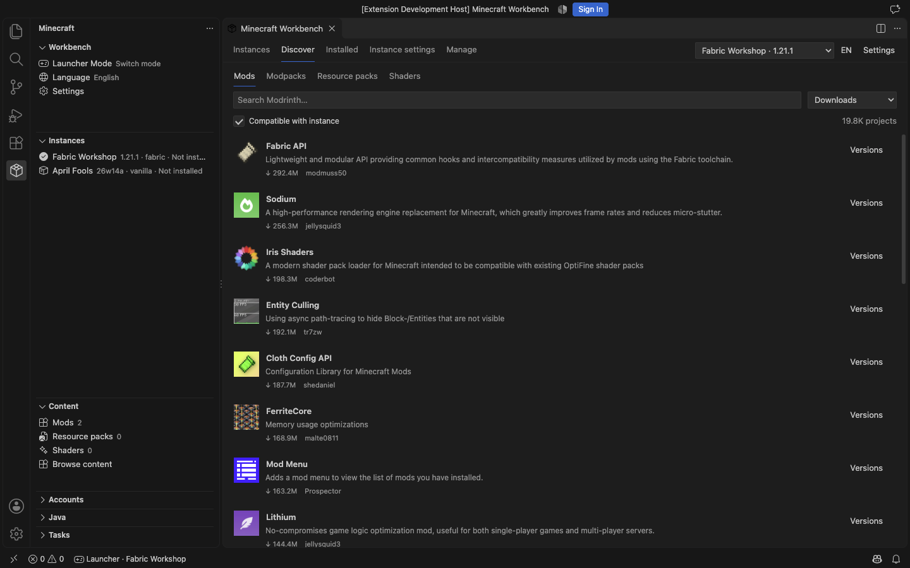
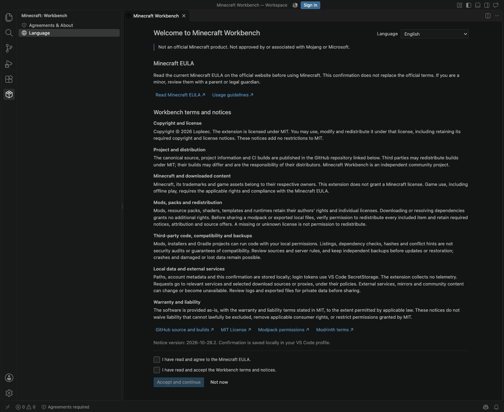
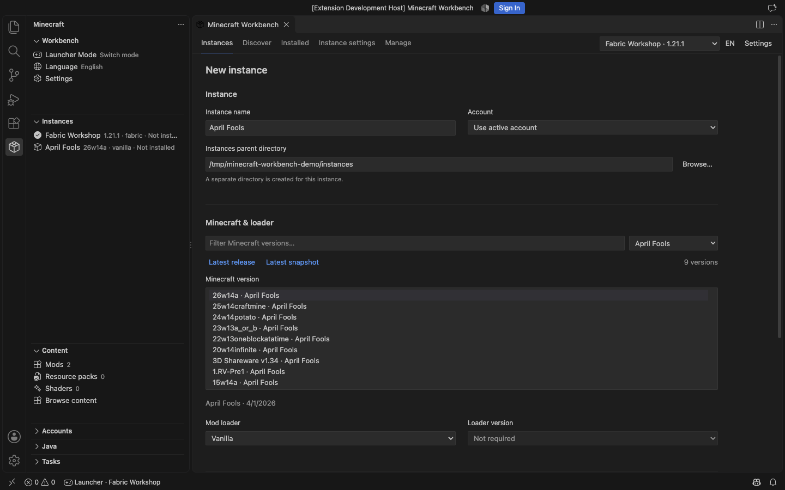
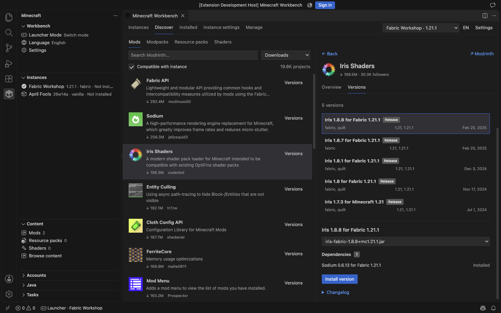
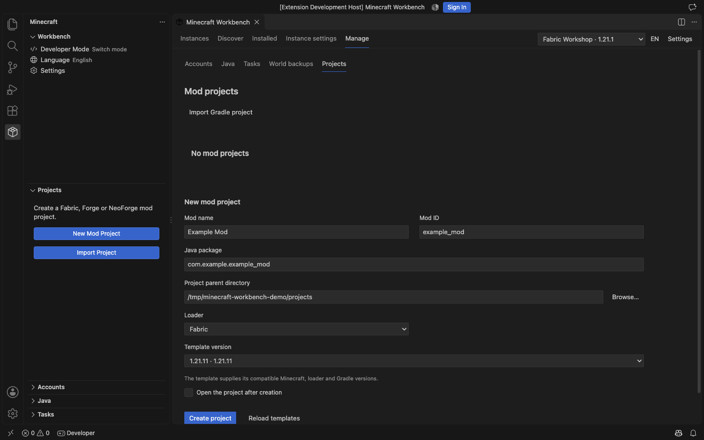
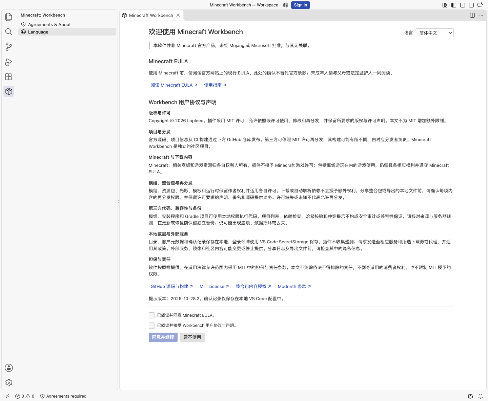
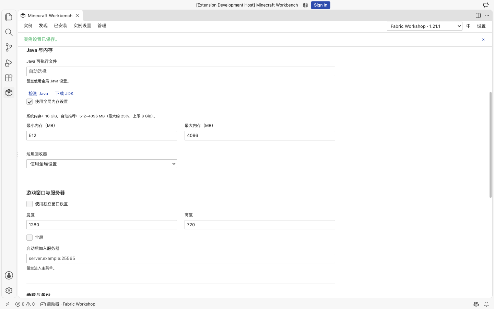

# Minecraft Workbench

A Minecraft Java Edition launcher and mod development workspace for VS Code.

[Releases](https://github.com/lopleec/VSCode-minecraft-workbench/releases/latest) · [简体中文](#简体中文) · [中文使用说明](README.zh-CN.md) · [MIT License](LICENSE)

Native sidebar views, commands, settings, tasks and output channels keep the extension at home in VS Code. Editor pages follow your theme, including light, dark and high contrast. The default language follows VS Code; English and Simplified Chinese can also be selected manually.



## Requirements and installation

- Desktop VS Code **1.103 or later**. Minecraft **Java Edition** only.
- A compatible Java runtime for the selected game version; use **Java → Detect Local Java** or **Download JDK**. Mod development requires a JDK.
- Internet access for initial downloads. A fully installed instance can launch with an offline account without refreshing the version manifest.
- In SSH, WSL or container workspaces, files and processes live on the **extension host machine**. Launching a game there requires a graphical session.

1. Open the [latest release](https://github.com/lopleec/VSCode-minecraft-workbench/releases/latest).
2. Under **Assets**, download `minecraft-workbench-<version>.vsix`.
3. In VS Code, run **Extensions: Install from VSIX…** and select the downloaded file.
4. Reload VS Code if prompted, then open **Minecraft** in the activity bar.

Use a trusted workspace to enable operations that download files or run processes. Development builds are available from successful [CI runs](https://github.com/lopleec/VSCode-minecraft-workbench/actions/workflows/ci.yml) under **Artifacts → minecraft-workbench-vsix**; unzip the artifact before installing its VSIX.

To build from source, use Node.js **22.14 or later**:

```sh
git clone https://github.com/lopleec/VSCode-minecraft-workbench.git
cd VSCode-minecraft-workbench
npm ci
npm run package
```

Install the generated `.vsix` using the same steps above.

### First use and agreements

The first run opens **Agreements & About**. Read the linked [Minecraft EULA](https://www.minecraft.net/en-us/eula) and the extension's [terms and notices](TERMS.md), then check both boxes and select **Accept and continue**. Both start unchecked. Choosing **Not now** closes the page and leaves extension operations unavailable.

Only agreement reading, language selection, confirmation and closing remain available; all other extension commands and operations stay locked. The sidebar Language command can still change the extension-wide preference before acceptance.

The page defaults to following the extension language. Its manual language selector changes only this page, leaving the extension, sidebar and VS Code preferences unchanged. The extension itself follows VS Code by default.



The confirmation stores only the notice version, time and two choices locally in the VS Code profile. Updated extension notices require confirmation again; the notice version is not a Mojang EULA version. **Agreements & About** remains available from the sidebar and Command Palette. This confirmation adds no restrictions to MIT and does not grant a Minecraft game license.

## Launcher Mode

1. Open **Instances → New instance**. Choose a name, game version, loader and parent directory.
2. Add an offline account in **Manage → Accounts**, or configure Microsoft sign-in below.
3. Detect, add or download Java from **Manage → Java**.
4. Choose **Install / Repair**, then **Launch**. You can also save an instance first and install it later.



The version list includes releases, snapshots and previews, April Fools versions, old Beta and old Alpha from Mojang's manifest. Vanilla, Fabric, Quilt, Forge and NeoForge are available where the selected version supports them. Loader prereleases are listed too. Change game or loader versions later, reinstall a loader, or repair a failed download from the instance pages.

| Area | Available controls |
| --- | --- |
| Instances | Independent game directories, version switching, repair, duplicate with or without worlds, move directory, last played and playtime |
| Launch | Per-instance account and Java, memory, GC, JVM and game arguments, window size, fullscreen, server auto-join |
| Content | Modrinth mods, modpacks, resource packs and shaders; local JAR/ZIP imports; enable, disable, remove and update |
| Worlds | Full `saves` backups, restore, optional backup before launch and retention limits |
| Downloads | Progress, cancellation, retry, resumable files, published hash verification, mirrors and proxies |
| Accounts and Java | Multiple offline/Microsoft accounts, account switching, local Java discovery and Eclipse Temurin downloads |

### Browse and manage content

Open **Content → Browse content**. Discover starts with the most downloaded projects, with icons, descriptions and download counts. Search or sort by relevance, followers, recent updates or newest releases. Choose an instance to apply Minecraft and loader compatibility filters.

**Versions** lists a project's releases with game, loader and release-channel filters. **Show all versions** also reveals incompatible releases; installation into an incompatible instance stays blocked. Selecting a version opens a dependency review before installation.



Required dependencies resolve recursively. Optional dependencies can be included separately. Fabric and Quilt checks inspect `fabric.mod.json`, embedded modules, version ranges and declared incompatibilities. Forge and NeoForge use Modrinth declarations and game/loader compatibility. Conflict checks help detect declared dependency problems, duplicate Fabric IDs and unreadable archives; they cannot predict every runtime or mixin conflict.

The **Installed** tab supports filtering, local imports, toggling files, removal and updates. Updates preserve disabled state and archive replaced files in `.workbench/history`. Shader packs require a compatible shader mod such as Iris or Oculus.

Import Modrinth `.mrpack` files locally or download packs from Discover. Imports create a new instance and apply common/client overrides, skipping server-only and optional client files. Export includes enabled content and configuration, with download references for recognized files and overrides for local files. Worlds, logs, server lists and account metadata are excluded. **CurseForge packs are not supported.**

### Memory and instance settings

Memory is adjusted **after creation**, in **Instance settings**, or globally in VS Code Settings. By default, minimum and maximum memory are `0` (automatic): the maximum uses **25% of system RAM**, rounded down to 128 MB and capped at 8 GiB; the minimum scales with it, usually 256–1024 MB. Change the percentage globally, or turn off **Use global memory settings** to set an instance's own limits. Explicit manual values take precedence.

Stop a running instance before changing its content, versions or restoring worlds. Restore automatically backs up the current worlds first. Deleting an instance moves its entire game directory to the operating system trash when supported.

## Accounts and Microsoft sign-in

**No Microsoft Client ID is bundled.** Leave it empty to use offline accounts. Offline identities do not authenticate to servers that require Microsoft/Minecraft authentication.

For Microsoft sign-in, enter your own public-client application ID in **Manage → Accounts** or `minecraftWorkbench.microsoftClientId`. It must support device code flow, personal Microsoft accounts, Xbox sign-in and Minecraft Services access. An application ID alone does not guarantee Minecraft Services approval. No client secret is needed or collected.

Sign-in uses Microsoft's device login page. Refresh and Minecraft access tokens are stored in **VS Code SecretStorage**, refreshed before expiry and before launch. A failed refresh requires signing in again. Removing an account deletes its saved credentials. Account names and UUIDs are local metadata. The extension collects no telemetry.

## Developer Mode

Switch modes from the sidebar or status bar, then open **Manage → Projects**.



1. Select **Fabric**, **Forge** or **NeoForge** and an official template/MDK version.
2. Enter the mod name, mod ID, Java package and project directory. The editable package suggestion uses `com.example.<mod_id>`.
3. Create the project. It opens automatically unless you disable that option. Existing projects with a Gradle wrapper can also be imported.
4. Use project actions to **build**, **clean**, **run the client**, **generate sources / IDE files** and view build artifacts.
5. For debugging, choose **Run client for debugging**. Once Gradle is listening, choose **Attach debugger**. Install **Debugger for Java** when prompted; the default port is 5005.

Gradle runs through the project's wrapper in VS Code Tasks. The first run downloads Gradle and project dependencies. Templates define compatible game, loader and Gradle versions; historical versions may have no maintained template. This creates mod projects, not decompiled standalone game clients. Extension proxy settings apply to extension-managed downloads; Gradle repositories and proxies follow Gradle/project configuration.

## Settings, downloads and storage

Open **Minecraft Workbench: Settings** to see the native grouped Settings page. **Change Language**, the sidebar language item and the **EN / 中** button switch language immediately. The extension language can be set independently from VS Code.

```json
{
  "minecraftWorkbench.language": "en",
  "minecraftWorkbench.minMemory": 0,
  "minecraftWorkbench.maxMemory": 0,
  "minecraftWorkbench.memoryPercentage": 25,
  "minecraftWorkbench.sources": {
    "manifest": "official",
    "assets": "bmclapi",
    "libraries": "bmclapi"
  }
}
```

- **Download sources:** choose `official`, `bmclapi` or an HTTPS base per resource type: `manifest`, `client`, `assets`, `libraries`, `loader`, `modrinth`, `java`, `project`. Custom bases preserve the original path/query. BMCLAPI applies only to supported endpoints; failed mirrors fall back to the original source. Authentication always uses official endpoints.
- **Proxy:** HTTP, HTTPS, SOCKS5 and SOCKS5h are supported. SOCKS5 resolves names locally; SOCKS5h resolves through the proxy. An empty setting falls back to VS Code `http.proxy`. Use **Set Proxy Credentials** to save credentials in SecretStorage. Reload after network or storage changes.
- **Download recovery:** `.part` files and HTTP Range validators allow resuming when the server supports it. A server ignoring ranges restarts the file. Published Minecraft/Modrinth hashes and JDK SHA-256 checks verify downloads.
- **Directories:** storage, game and project locations are configurable. Each game directory contains `.runtime` for dependencies and `.workbench` for metadata, history and backups; move them with the instance.
- **Diagnostics:** use **Show Output** or **Open Game Log**. Extension output redacts authentication tokens and proxy credentials. Review external game/mod logs before sharing them.

## Development and validation

```sh
npm ci
npm test
npm run format:check
npm run legal -- --check
npm run compile
npm run test:host
npm run package
```

Press **F5** to open an Extension Development Host. Unit tests cover path safety, state persistence and recovery, accounts, range downloads, hashes, dependency resolution, backups and project customization. CI checks formatting, tests, compilation and packaging on Linux, Windows and macOS.

Host tests require network access and a local or downloadable VS Code. `VSCODE_EXECUTABLE` selects a local executable; `MW_LIVE_INSTALL=1` also downloads a test Fabric instance. Microsoft sign-in needs an approved application and account and is not exercised automatically. Game launch and Gradle builds have been checked on macOS Apple Silicon; other platforms and every historical game/loader combination have not been manually verified.

Screenshots show the running extension in VS Code with sample instances and live Modrinth metadata. Project icons and descriptions belong to their respective authors.

## Feedback and contributions

Bug reports, feature requests, translations and pull requests are welcome.

- **Bugs:** search [existing issues](https://github.com/lopleec/VSCode-minecraft-workbench/issues) first, then [open an issue](https://github.com/lopleec/VSCode-minecraft-workbench/issues/new). Include reproduction steps, expected and actual behavior, extension and VS Code versions, operating system and architecture. For game issues, include the Minecraft, loader and Java versions, relevant mods and a short log excerpt.
- **Feature requests:** describe the use case and the workflow you would like to improve in an [issue](https://github.com/lopleec/VSCode-minecraft-workbench/issues/new). Screenshots or small examples help explain UI suggestions.
- **Pull requests:** fork the repository, create a branch and keep the change focused. Explain the problem, the change and how it was checked. Discuss substantial changes in an issue first. Follow the existing code style, update both languages when changing UI text or documentation, and include screenshots for UI changes. Run the relevant checks listed above before opening a [pull request](https://github.com/lopleec/VSCode-minecraft-workbench/pulls).

Remove tokens, proxy credentials, account details and personal paths from shared logs and screenshots. Keep downloaded game files, worlds, local instance data and generated VSIX files out of source contributions. Contributions are licensed under the project's [MIT License](LICENSE); third-party content retains its own license.

## License and acknowledgements

[MIT](LICENSE), Copyright © 2026 Lopleec. Bundled dependency licenses are included in [THIRD_PARTY_NOTICES.md](THIRD_PARTY_NOTICES.md) and [THIRD_PARTY_LICENSES.txt](THIRD_PARTY_LICENSES.txt).

Built with the [VS Code API](https://code.visualstudio.com/api), [XMCL](https://xmcl.app/en/core/), [Modrinth API](https://docs.modrinth.com/api/), and official [Fabric](https://docs.fabricmc.net/develop/getting-started/creating-a-project), [Forge](https://docs.minecraftforge.net/en/latest/gettingstarted/) and [NeoForge](https://docs.neoforged.net/docs/gettingstarted/) templates. Independent of Mojang, Microsoft, Modrinth and the loader projects. Game files, accounts and downloaded content retain their respective terms and licenses.

---

## 简体中文

在 VS Code 中启动 Minecraft Java 版、管理实例并开发模组。使用原生侧栏、命令、设置、任务和输出窗口；编辑器页面适配深色、浅色与高对比主题。默认跟随 VS Code 语言，也可单独手动选择英文或简体中文。

### 安装与开始使用

需要桌面版 **VS Code 1.103+**，仅支持 **Minecraft Java 版**。游戏所需 Java 可在插件中检测、手动添加或下载；开发模组需要 JDK。首次下载需要网络，完整安装后可使用离线账户启动，无需重新获取版本清单。

1. 打开 [最新 Release](https://github.com/lopleec/VSCode-minecraft-workbench/releases/latest)。
2. 在 **Assets** 中下载 `minecraft-workbench-<版本号>.vsix`。
3. 在 VS Code 中执行 **扩展：从 VSIX 安装…**，选择下载的文件。
4. 按提示重新加载 VS Code，然后打开活动栏中的 **Minecraft**。

下载和启动进程需要受信任的工作区。开发构建可从成功的 [CI 运行](https://github.com/lopleec/VSCode-minecraft-workbench/actions/workflows/ci.yml) 中下载 **Artifacts → minecraft-workbench-vsix**，解压后安装其中的 VSIX。

也可使用 **Node.js 22.14+** 从源码打包：

```sh
git clone https://github.com/lopleec/VSCode-minecraft-workbench.git
cd VSCode-minecraft-workbench
npm ci
npm run package
```

生成的 `.vsix` 按上面的步骤安装。SSH、WSL、容器中的文件和进程位于扩展宿主机器；在远程机器运行游戏需要图形环境。

### 首次使用与协议

首次打开会显示 **协议与关于**。阅读链接中的 [Minecraft EULA](https://www.minecraft.net/en-us/eula) 与插件的 [用户协议和声明](TERMS.md)，勾选两项后选择 **同意并继续**。两项默认均未勾选；选择 **暂不使用** 会关闭页面，插件操作保持不可用。

未同意时仅开放协议阅读、语言选择、确认与关闭，其余插件命令和操作均锁定；侧栏“语言”仍可修改插件整体的语言。

协议页默认跟随插件语言；手动选择只改变协议页，不修改插件、侧栏或 VS Code 的语言设置。插件整体默认跟随 VS Code。



仅将提示版本、确认时间和两项选择保存在本地 VS Code 配置中。插件提示更新后需重新确认；此版本号不代表 Mojang EULA 版本。之后可通过侧栏或命令面板的 **协议与关于** 再次查看。此确认不为 MIT 增加限制，也不授予 Minecraft 游戏许可。

### 启动模式

1. 打开 **实例 → 新建实例**，填写名称，选择游戏版本、加载器和父目录。
2. 在 **管理 → 账户** 添加离线账户，或按下文配置 Microsoft 登录。
3. 在 **管理 → Java** 检测、添加 Java 或下载 Eclipse Temurin JDK。
4. 选择 **安装 / 修复**，完成后启动。也可先保存实例，稍后安装。

版本列表包含 Mojang 清单中的正式版、快照与预发布版、愚人节版本、旧 Beta 和旧 Alpha。支持对应游戏版本可用的 Vanilla、Fabric、Quilt、Forge、NeoForge，以及 Loader 测试版本。创建后可以更改游戏版本、更新或重装 Loader，失败后可修复重试。

| 功能 | 支持内容 |
| --- | --- |
| 实例 | 独立游戏目录、版本切换、修复、复制（可选存档）、移动目录、上次启动与游戏时长 |
| 启动 | 独立账户与 Java、内存、GC、JVM / 游戏参数、窗口尺寸、全屏、自动加入服务器 |
| 内容 | Modrinth 模组、整合包、资源包、光影；导入本地 JAR/ZIP；启用、禁用、删除、更新 |
| 存档 | 完整 `saves` 备份与恢复、可选启动前备份、保留数量 |
| 下载 | 进度、取消、重试、断点续传、哈希校验、镜像与代理 |
| 账户与 Java | 多离线 / Microsoft 账户切换、本地 Java 检测、Temurin 下载 |

### 内容浏览与依赖

从 **内容 → 浏览内容** 打开页面。发现页默认按下载量展示项目图标、简介和下载数，也可搜索或按相关度、关注数、更新与发布时间排序。选择实例后，可按游戏版本和 Loader 筛选兼容内容。

**版本** 支持游戏版本、Loader 和发布类型筛选；**查看全部版本** 会显示不兼容版本，但不能将它们安装进当前实例。选定版本后先查看依赖计划，再安装。必需前置递归解析，可选依赖可单独勾选。

Fabric / Quilt 会读取 `fabric.mod.json`、内嵌模块、版本范围和声明的不兼容项；Forge / NeoForge 使用 Modrinth 声明及游戏、Loader 兼容性信息。冲突检查可发现声明的依赖问题、重复 Fabric ID、损坏文件，不能预测所有运行时或 Mixin 冲突。

**已安装** 页面支持筛选、导入本地文件、启用、禁用、删除和更新。更新保留禁用状态，旧文件存放在 `.workbench/history`。光影包需配合 Iris、Oculus 等兼容模组。

支持从本地或 Modrinth 导入 `.mrpack`，新建实例并应用公共及客户端覆盖文件，跳过仅服务端和客户端可选文件。导出包含已启用内容与配置：已识别文件使用下载引用，本地文件作为覆盖文件。排除存档、日志、服务器列表和账户元数据。**暂不支持 CurseForge 整合包。**

### 内存、语言与实例设置

内存在**创建后的实例设置**或全局设置中调整。默认最小、最大内存为 `0`（自动）：最大值取**系统内存的 25%**，向下取整到 128 MB，上限 8 GiB；最小值随之调整，通常为 256–1024 MB。可修改全局百分比，或取消 **使用全局内存设置**，为实例单独填写。手动值优先。



通过 **切换语言**、侧栏语言入口或 **EN / 中** 按钮即时切换。语言可独立于 VS Code 设置。

修改内容、版本或恢复存档前需停止实例。恢复前自动备份当前存档。删除实例会将整个游戏目录移至系统废纸篓（系统支持时）。

### 账户与 Microsoft 登录

**插件不内置 Microsoft Client ID**；留空时使用离线账户。离线身份无法通过要求 Microsoft / Minecraft 验证的服务器认证。

正版登录需在 **管理 → 账户** 或 `minecraftWorkbench.microsoftClientId` 中填写自己的公共客户端应用 ID。应用必须支持设备代码流程、个人 Microsoft 账户、Xbox 登录并获得 Minecraft Services 访问许可；仅创建应用 ID 不保证获得 Minecraft Services 许可。不需要也不会收集客户端密钥。

通过 Microsoft 设备登录页面授权。刷新令牌和 Minecraft 访问令牌存于 **VS Code SecretStorage**，到期前及启动前自动刷新；刷新失败需重新登录。移除账户会删除保存的凭据，账户名和 UUID 作为本地元数据保存。插件不收集遥测。

### 开发模式

在侧栏或状态栏切换模式，打开 **管理 → 项目**。

1. 选择 **Fabric / Forge / NeoForge** 和官方模板或 MDK 版本。
2. 填写模组名称、ID、Java 包名和目录。包名建议使用通用的 `com.example.<mod_id>`，可自行修改。
3. 创建后自动打开项目，也可关闭该选项；支持导入包含 Gradle wrapper 的已有项目。
4. 项目操作支持构建、清理、启动客户端、生成源码 / IDE 文件和查看构建产物。
5. 调试时先选择 **启动客户端并等待调试**，待 Gradle 监听端口后 **附加调试器**。按提示安装 **Debugger for Java**，默认端口 5005。

Gradle 通过项目 wrapper 在 VS Code Tasks 中运行，首次会下载 Gradle 与依赖。模板提供对应的游戏、Loader 和 Gradle 版本，部分历史版本没有维护中的模板。生成的是模组项目，并非反编译后的独立游戏客户端。插件代理用于插件管理的下载；Gradle 的仓库与代理遵循项目及 Gradle 配置。

### 网络、目录与诊断

全局选项位于 **Minecraft Workbench：设置** 的原生分组中。

```json
{
  "minecraftWorkbench.language": "zh-cn",
  "minecraftWorkbench.minMemory": 0,
  "minecraftWorkbench.maxMemory": 0,
  "minecraftWorkbench.memoryPercentage": 25,
  "minecraftWorkbench.sources": {
    "manifest": "official",
    "assets": "bmclapi",
    "libraries": "bmclapi"
  }
}
```

- **下载源：** 可按 `manifest`、`client`、`assets`、`libraries`、`loader`、`modrinth`、`java`、`project` 设置 `official`、`bmclapi` 或 HTTPS 基地址。自定义地址保留原路径和查询参数；BMCLAPI 仅用于支持的端点。镜像失败回退原始地址，认证始终走官方端点。
- **代理：** 支持 HTTP、HTTPS、SOCKS5、SOCKS5h；SOCKS5 本地解析域名，SOCKS5h 由代理解析。留空时沿用 VS Code `http.proxy`。使用 **设置代理凭据** 将凭据存入 SecretStorage。修改网络、存储配置后需重载窗口。
- **断点与校验：** 保留 `.part`，在服务器支持时使用 HTTP Range 和校验器续传；服务器忽略范围则重新下载。校验 Minecraft / Modrinth 公布的哈希及 JDK SHA-256。
- **目录：** 存储、游戏和项目目录可配置。游戏目录中的 `.runtime` 保存运行依赖，`.workbench` 保存元数据、历史和备份，移动实例时应一起保留。
- **日志：** 使用 **显示输出** 或 **打开游戏日志**。插件输出会隐藏认证令牌和代理凭据；分享外部游戏或模组日志前仍需检查内容。

### 开发与验证

```sh
npm ci
npm test
npm run format:check
npm run legal -- --check
npm run compile
npm run test:host
npm run package
```

按 **F5** 打开扩展开发宿主。单元测试覆盖路径安全、状态保存及失败恢复、账户、续传、哈希、依赖、备份和项目定制。CI 在 Linux、Windows 和 macOS 检查格式、测试、编译和打包。

宿主测试需要网络与本地或可下载的 VS Code。`VSCODE_EXECUTABLE` 可指定本地程序，`MW_LIVE_INSTALL=1` 会额外下载安装 Fabric 测试实例。Microsoft 登录需要获批应用和账户，不自动测试。游戏启动和 Gradle 构建已在 macOS Apple Silicon 验证，其他平台及所有历史游戏 / Loader 组合尚未逐一人工验证。

截图来自 VS Code 中运行的插件，使用示例实例和实时 Modrinth 元数据。项目图标、简介属于各自作者。

### 反馈与贡献

欢迎提交问题、功能建议、翻译改进和 Pull Request。

- **问题反馈：** 请先搜索[已有 Issue](https://github.com/lopleec/VSCode-minecraft-workbench/issues)，再[创建 Issue](https://github.com/lopleec/VSCode-minecraft-workbench/issues/new)。提供复现步骤、预期与实际表现、插件及 VS Code 版本、系统与架构。游戏相关问题请附上 Minecraft、Loader、Java 版本、相关模组和简短日志。
- **功能建议：** 在 [Issue](https://github.com/lopleec/VSCode-minecraft-workbench/issues/new) 中说明使用场景和希望改善的操作流程。界面建议可附截图或小示例。
- **提交 PR：** Fork 仓库并创建分支，每个 PR 聚焦一项改动，说明问题、修改内容和验证方式。较大改动建议先通过 Issue 讨论。遵循现有代码风格，修改界面文案或文档时同步更新中英文，界面改动附上截图。提交 [Pull Request](https://github.com/lopleec/VSCode-minecraft-workbench/pulls) 前运行上文列出的相关检查。

分享日志和截图前，请移除令牌、代理凭据、账户信息和个人路径。源码贡献中不要包含下载的游戏文件、存档、本地实例数据或生成的 VSIX。贡献采用项目的 [MIT License](LICENSE)，第三方内容保留各自许可。

### 许可与致谢

[MIT License](LICENSE)，Copyright © 2026 Lopleec。依赖许可见 [THIRD_PARTY_NOTICES.md](THIRD_PARTY_NOTICES.md) 和 [THIRD_PARTY_LICENSES.txt](THIRD_PARTY_LICENSES.txt)。

使用 VS Code API、XMCL、Modrinth API，以及 Fabric、Forge、NeoForge 官方模板。本项目独立于 Mojang、Microsoft、Modrinth 和各 Loader 项目。游戏文件、账户与下载内容仍适用各自条款和许可。
